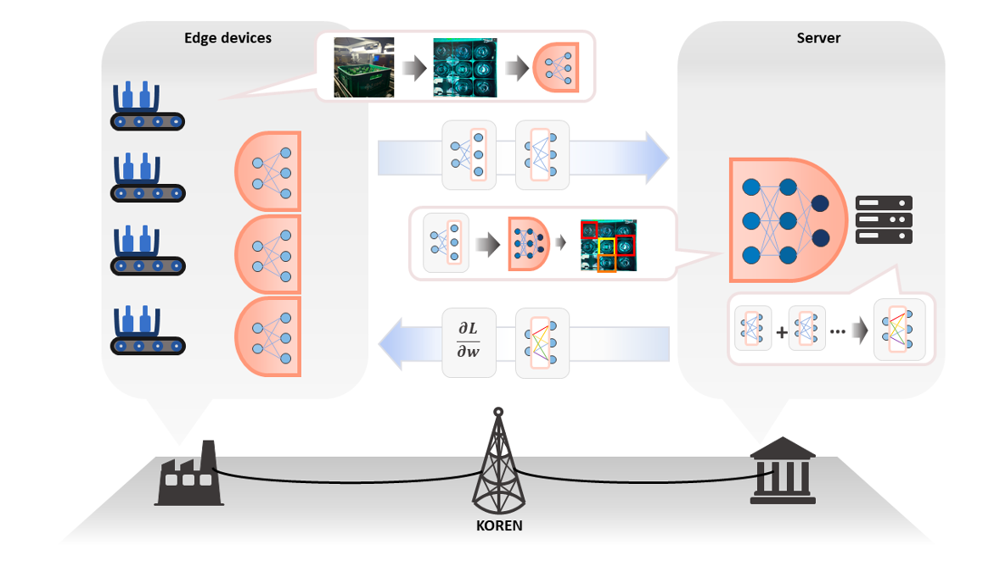
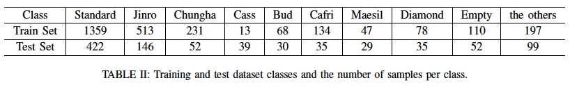
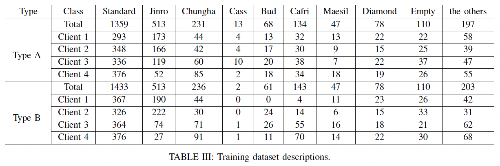
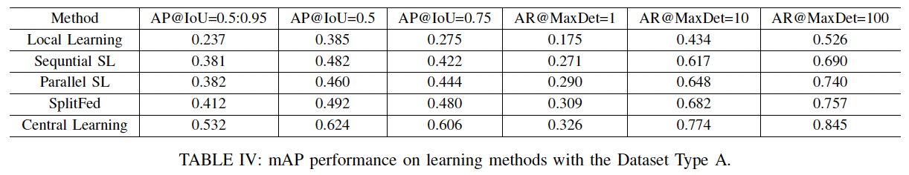
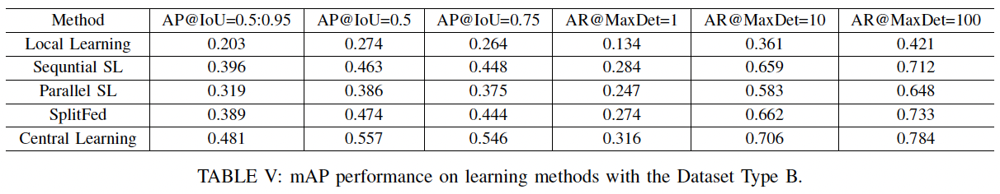
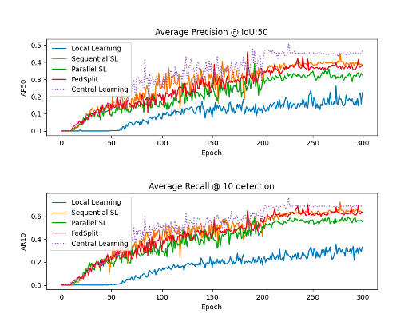
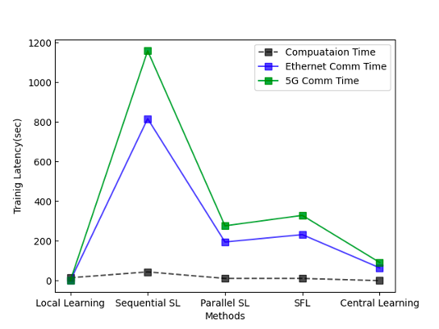

# YOLOv4 Split Learning over 5G and Commercial Networks

**Distributed Object Detection · Split Learning · Multi-Access Edge Computing (MEC)**

An experimental framework for training a **YOLOv4-based object detector across geographically separated computing servers** using **5G wireless and commercial wired network connectivity**. It investigates split learning for distributed edge–server computation with real network infrastructure.


> **Research status:** Unpublished experimental work. This project is separate from the IEEE ICC Workshops 2022 smart brewing factory demo paper.

---

## System Overview

The framework divides model computation between a **local client** and a **remote server**. The existing project documentation supports two operating modes: both model components on one machine, or the components on separate machines communicating through an accessible port. The distributed experiments use a network environment incorporating **5G wireless access and commercial wired connectivity**.

**Experimental workflow**

1. Prepare annotated bottle images and divide training samples across client datasets.
2. Launch the local model component for client-side computation.
3. Connect local and server components over the configured network port for split-model learning.
4. Run collaborative training involving remote server-side computation.
5. Evaluate object-detection performance under different distributed-learning methods and dataset distributions.

*This is a high-level description. Exact split-layer placement, transferred tensors, gradient-exchange protocol, and synchronization scheduling require confirmation from implementation code.*

### System Architecture



*Figure: Experimental architecture. Upload `exp3.png` to the `assets` folder.*

---

## Getting Started

The entry points in the original repository documentation are:

**Server**
```bash
python Server/main_server.py -val_label_path Yourfolder/label -dir Yourfolder/Test -g 0
```

**Local client**
```bash
python Local/main_local.py -train_label_path Yourfolder/label -dir Yourfolder/Test -g 0
```

Configure the local and server processes for the same machine or for two servers reachable over a shared network port. Check addresses, ports, dependencies, dataset paths, and launch order in the scripts before running.

---

## Dataset

The experiment includes ten bottle-related categories: **Standard, Jinro, Chungha, Cass, Bud, Cafri, Maesil, Diamond, Empty, and Others**. Dataset configurations **Type A** and **Type B** distribute training samples across four clients.

### Training and Test Dataset



### Client-Wise Training Data Distribution



---

## Experimental Results

The experiments compare **Local Learning, Sequential SL, Parallel SL, SplitFed, and Central Learning** using object detection average precision (AP) and average recall (AR).

### Dataset Type A



### Dataset Type B



**Selected AP@[IoU=0.5:0.95] results**

| Method | Type A | Type B |
|:--|--:|--:|
| Local Learning | 0.237 | 0.203 |
| Sequential SL | 0.381 | 0.396 |
| Parallel SL | 0.382 | 0.319 |
| SplitFed | 0.412 | 0.389 |
| Central Learning | 0.532 | 0.481 |

SplitFed improves AP@[IoU=0.5:0.95] over Local Learning in both dataset configurations, while Central Learning records the highest AP among the compared methods. These are **unpublished project results**, not peer-reviewed publication claims.

### Additional Experimental Graphs

<table>
  <tr>
    <td width="50%" align="center"><br/><sub>Experimental result graph 1</sub></td>
    <td width="50%" align="center"><br/><sub>Experimental result graph 2</sub></td>
  </tr>
</table>

*Upload `exp4.png` and `exp5.png` to `assets/` to display these figures.*

---

## Repository Structure

```text
Yolov4_split_learning/
├── Local/
│   └── main_local.py
├── Server/
│   └── main_server.py
├── README.md
└── assets/
    ├── tab1.png
    ├── tab2.png
    ├── tab3.png
    ├── tab4.png
    ├── exp3.png      # Add this file
    ├── exp4.png      # Add this file
    └── exp5.png      # Add this file
```

---

## Related Deployment

[](https://github.com/NamHyelin/SmartFactory_inference)

The industrial inference/deployment repository and the **unpublished networked split-learning experiments** documented here are separate projects.

---

## References & Acknowledgments

This project builds upon an existing PyTorch implementation of YOLOv4.

[](./YOLOv4_REFERENCE.md)
